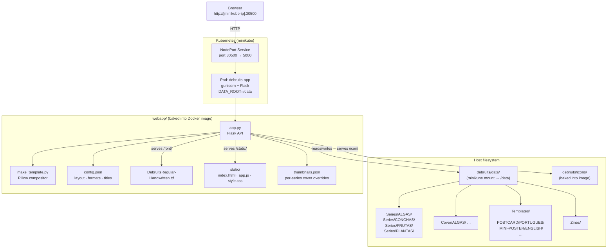
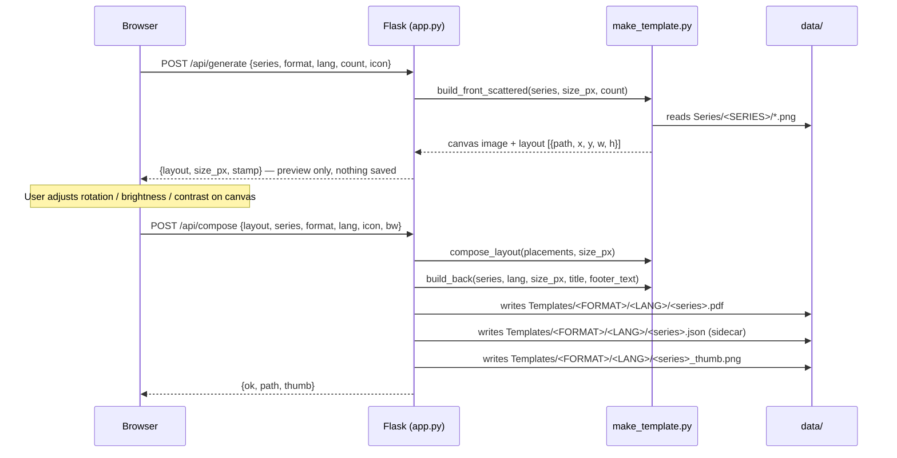
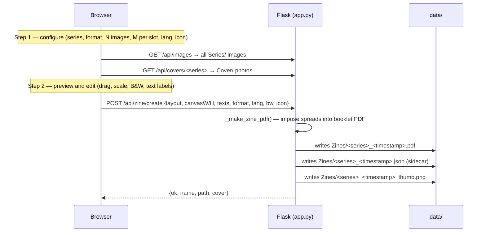

# DE BRUITS — Architecture

## System overview



---

## Data directory layout

```
data/                        ← mounted at /data in k8s, ./data locally
├── Series/
│   ├── ALGAS/               ← *_upscaled.png source images
│   ├── CONCHAS/
│   ├── FRUTAS/
│   └── PLANTAS/
├── Cover/
│   ├── ALGAS/               ← cover photos (PNG/JPG/WEBP)
│   └── …
├── Templates/               ← auto-created on first print save
│   ├── POSTCARD/
│   │   ├── PORTUGUES/
│   │   │   ├── ALGAS.pdf
│   │   │   ├── ALGAS.json   ← sidecar: layout, series, format, lang, icon
│   │   │   └── ALGAS_thumb.png
│   │   └── ENGLISH/ …
│   ├── MINI-POSTER/ …
│   └── POSTER/ …
└── Zines/                   ← auto-created on first zine save
    ├── ALGAS_20250101_120000.pdf
    ├── ALGAS_20250101_120000.json
    └── ALGAS_20250101_120000_thumb.png
```

---

## Print creation flow



---

## Zine creation flow



---

## API routes

| Method | Path | Description |
|--------|------|-------------|
| GET | `/` | Single-page app (index.html) |
| GET | `/static/*` | CSS, JS |
| GET | `/font/<name>` | Custom TTF font |
| GET | `/icon/<name>` | Stamp icon PNG |
| GET/PUT | `/api/config` | Read / update config.json |
| GET | `/api/images` | List all Series/ source images with metadata |
| GET | `/api/covers/<series>` | List Cover/<SERIES>/ photos |
| GET | `/api/icons` | List icons/ stamps |
| GET/PUT | `/api/thumbnails` | Per-series cover thumbnail overrides |
| GET | `/api/templates` | List saved prints (with sidecar metadata) |
| DELETE | `/api/templates` | Delete selected prints |
| GET | `/api/layout-data/<path>` | Sidecar JSON for a saved print |
| POST | `/api/generate` | Preview layout (no disk write) |
| POST | `/api/compose` | Render + save print PDF |
| POST | `/api/refresh-prints` | Re-render all prints from their sidecars |
| GET | `/api/download/<path>` | Download one print PDF |
| GET | `/api/download-all` | Zip all print PDFs |
| GET | `/api/zines` | List saved zines |
| POST | `/api/zine/create` | Render + save zine PDF |
| DELETE | `/api/zines/delete` | Delete selected zines |
| POST | `/api/refresh-zines` | Re-render all zines from their sidecars |
| GET | `/api/zines/download/<name>` | Download one zine PDF |
| GET | `/api/zines/download-all` | Zip all zine PDFs |
| GET | `/img/<path>` | Serve image from DATA_ROOT |

---

## make_template.py functions

| Function | Used by | Description |
|----------|---------|-------------|
| `build_front_scattered()` | `api_generate` | Random scattered layout of N images from a series |
| `compose_layout()` | `api_compose`, `api_refresh_prints`, `api_refresh_zines` | Compose exact pixel placements into final canvas |
| `build_back()` | `api_compose`, `api_refresh_prints` | Render print back face (title + footer text) |
| `place_stamp()` | `build_front_scattered`, `compose_layout` | Stamp icon (PNG with alpha) in bottom-right corner |
| `collect_images()` | `build_front_scattered` | Scan `Series/<SERIES>/` for `*_upscaled.png` or `*.png` |

---

## Print formats

| Format | Page size | Canvas px (300 dpi) | Paper fit |
|--------|-----------|---------------------|-----------|
| Postcard | 10.5 x 16.5 cm | 2480 x 3898 | 10 x 15 cm standard |
| Mini Poster | 16.5 x 27 cm | 3898 x 6378 | A5 - 14.8 x 21 cm |
| Poster | 21 x 30.5 cm | 4961 x 7205 | A4 - 21 x 29.7 cm |

Zine spreads are rendered at 300 dpi per page and imposed into a booklet-order PDF (print → fold in half).

---

## Kubernetes deployment

```
minikube (Docker driver)
└── debruits namespace
    ├── Deployment: debruits
    │   └── Pod
    │       ├── image: debruits-app:latest  (imagePullPolicy: Never)
    │       ├── env:   DATA_ROOT=/data
    │       ├── port:  5000
    │       └── volumeMount: /data ← hostPath /data
    └── Service: debruits  (NodePort 30500)

Host:
  debruits/data/  ──minikube mount──▶  /data  (9p filesystem)
```

**Why `minikube mount` is required:** With the Docker driver, minikube runs inside a Docker container, so host paths are not directly accessible. `minikube mount` starts a 9p filesystem server that exposes the host directory to the minikube VM and in turn to pods via `hostPath`.

---

## Interests dashboard (optional, separate app)

`webapp/interests/` is a standalone FastAPI app that runs independently on port 5001. It is not part of the main Flask app and is not deployed in k8s.

```
webapp/interests/
├── app/
│   ├── main.py          FastAPI app + endpoints
│   ├── claude_client.py  Claude API (tech concept, fact, music)
│   ├── calendar_client.py ICS calendar feed
│   ├── email_client.py   Gmail IMAP
│   ├── github_client.py  GitHub read-only
│   ├── spotify_client.py Spotify track lookup
│   ├── storage.py        JSON run history on disk
│   └── config.py         Env-var config (API keys, credentials)
└── templates/
    └── index.html        Jinja2 dashboard template
```

To run: `cd webapp/interests && uvicorn app.main:app --port 5001`

---

## Legacy code

`legacy/` contains early GAN experiments and a Vue.js prototype frontend. These are archived and not in use.
